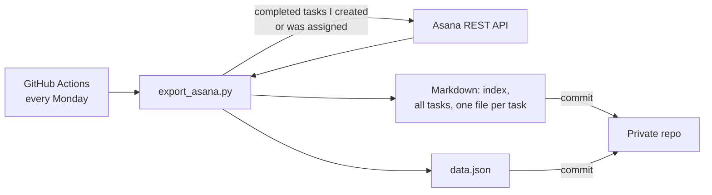

# Asana Work Log Export

> A small automation that exports every Asana task I've completed, with descriptions and full comment threads, to Markdown and JSON every Monday through GitHub Actions. It's my running record of work done.

**When:** June 2026, running weekly since
**Stack:** Python 3.12 (requests) · Asana REST API · GitHub Actions (scheduled workflow) · Markdown / JSON
**My role:** Built and run it. Built with Claude Code as an AI pair programmer.

> The exported tasks contain internal company details, so that repository stays private. This page describes how it works.

---

## How it works

- Pulls every **completed** task I created or was assigned, plus each task's description and full comment thread.
- Writes readable Markdown (an index, one combined file and one file per task) and structured JSON.
- Each run regenerates the export so it always reflects the full history.
- The Asana token is stored as a GitHub Actions secret, never in the code.

## A detail worth noting

Asana's task search endpoint doesn't support offset pagination, so a large history can't be paged straight through. The script works around it by **windowing on completion date** and stitching the windows together.

## Results

- About 290 completed tasks exported over my first ~4.5 months in the role (late April – early September 2026), updated automatically every week.
- I use it to keep my own record of tickets, projects and the tools I've worked with.

---

*See my [profile](https://github.com/Matteoinfl) for my other projects.*
